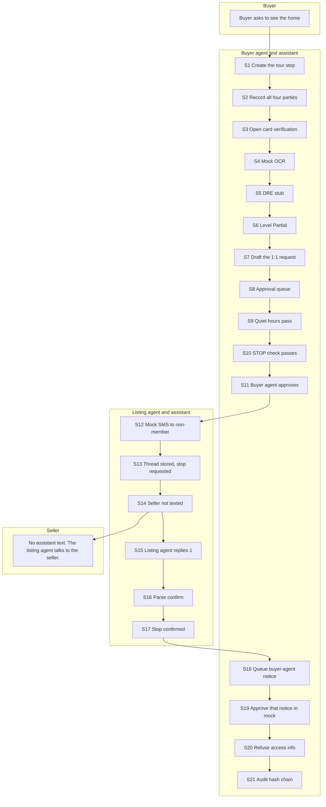

# SmartShowings flow

Text-first showing coordination for four parties: the buyer, the buyer agent and their assistant, the listing agent and their assistant, and the seller. There are no AI voice calls and no group texts. Each party has a separate 1:1 thread.

The assistant never sends lockbox, gate, alarm, or other access details. SMS and email stay in mock mode until the owner changes one environment variable (see the bottom of this page).

Numbered steps match `npm run test:smartshowings`. Branch ids are the failure and edge paths.

## Happy path



## Branches

```mermaid
flowchart TD
  S4["S4 OCR"] --> S6F["S6F Blank card is Failed"]
  S5["S5 DRE stub"] --> S6N["S6N Not licensed is Failed"]
  S6["S6 Partial"] --> S6V["S6V Attest to Verified, access still blocked"]
  S7["S7 Draft"] --> S8B["S8B Missing address"]
  S7 --> S8H["S8H No phone and no email"]
  S7 --> S8E["S8E Email fallback, still mock"]
  S9["S9 Daytime"] --> S9H["S9H Night draft is held"]
  S10["S10 STOP check"] --> S10X["S10X Opt-out body is refused"]
  S12["S12 Non-member SMS"] --> S12M["S12M Member is in-app"]
  S14["S14 Seller stays quiet"] --> S14M["S14M Member gets a separate 1/2/3 thread"]
  S15["S15 Reply 1"] --> S15R["S15R Reply 2 reschedules"]
  S15 --> S15D["S15D Reply 3 declines"]
  S15 --> S15U["S15U Free text escalates"]
  S15 --> S15S["S15S STOP opts out"]
```



## Steps

| ID | What happens |
| --- | --- |
| S1 | Buyer agent creates a tour stop with the address and time window. |
| S2 | Buyer, buyer agent, listing agent, and seller are parties. No thread exists yet, and none of them share a group text. |
| S3 | Requester verification opens when a business-card photo is attached. |
| S4 | A mocked vision model extracts name, DRE number, brokerage, and phone. xAI is not called. |
| S5 | The DRE adapter returns unknown. It does not scrape the public lookup. |
| S6 | A card with a name and DRE is Partial while that adapter is unknown. Access info stays off. |
| S6F | A card with no name and no DRE is Failed. |
| S6N | A not-licensed or name-mismatch result is Failed. Attestation cannot upgrade it. |
| S6V | A person can attest Partial to Verified. The assistant still refuses access info. |
| S7 | The buyer assistant drafts one message to the listing agent. It says it is an AI assistant for the buyer agent and includes STOP. |
| S8 | The draft enters the approval queue. The audit log records `queued`. |
| S8B | No address: nothing is queued. |
| S8H | No phone and no email: a person has to make the call. |
| S8E | No mobile number: the draft is email. SendGrid is not called while email mode is mock. |
| S9 | Between 8:00 a.m. and 8:00 p.m. Pacific, the draft is allowed to proceed. |
| S9H | At night the draft is held. It is not sent. Someone approves it again after 8:00 a.m. Nothing sends it automatically. |
| S10 | The outbound draft is not itself an opt-out. |
| S10X | A body that is only STOP, or another opt-out, is refused. |
| S11 | The buyer agent approves the queued request. Delivery has not happened yet. |
| S12 | A listing agent who is not a user gets one mock SMS. `delivered` stays false. Twilio is not called. |
| S12M | A listing agent who is a user is routed in-app instead of SMS. |
| S13 | The counterparty thread is 1:1 and the tour stop becomes `requested`. |
| S14 | The showing profile keeps `ask` and `occupantNotify: agent`. The seller is not texted. A non-member already received the plain SMS, so they are not sent a second control text. |
| S14M | When the listing belongs to a user, their assistant queues `1` approve, `2` suggest a time, `3` decline on a `listing_control` thread. The seller is still not texted. |
| S15 | The listing agent replies `1`. |
| S15R | Reply `2`, or a suggested time, leaves the stop pending and asks a person to review it. |
| S15D | Reply `3` or NO sets the stop to declined. |
| S15U | Free text does not confirm. An escalation sits in the queue. |
| S15S | STOP writes the number onto the do-not-contact list, marks the thread opted out, and blocks a later send. |
| S16 | `1` parses as confirm. |
| S17 | The tour stop becomes confirmed. |
| S18 | The buyer agent is notified on a separate in-app thread. A confirmation back to the listing agent is a different queued SMS. The buyer and the seller are not put on one text. |
| S19 | Approving the buyer notice records an in-app mock. Nothing goes to a carrier. |
| S20 | Even a Verified requester cannot make the assistant send a lockbox, gate, or alarm code. |
| S21 | Audit entries form a hash chain. Twilio, email, and xAI counters stay at zero. |

## Switching delivery to live

SmartShowings itself is on by default. Delivery is not.

After Twilio A2P 10DLC is approved, real SMS is one variable:

```bash
SMART_SHOWINGS_SMS_MODE=live
```

Real email is the same kind of change, separately:

```bash
SMART_SHOWINGS_EMAIL_MODE=live
```

Leave both at `mock` until then. Tests and the dev simulator refuse to run when either mode is `live`.

## Dev simulator

`npm run dev`, then open `/showings/simulator`. That route exists only in a Vite dev build. It walks these step ids locally. It does not call Twilio, SendGrid, or xAI.
